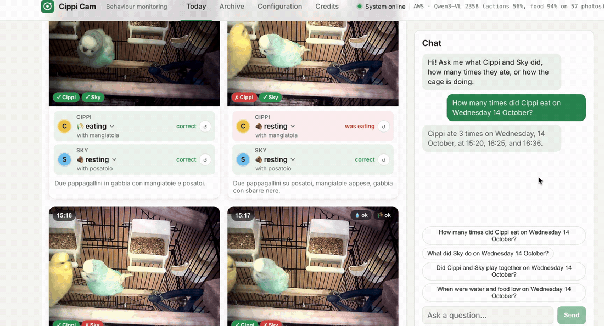
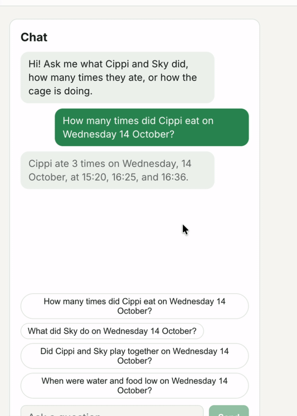
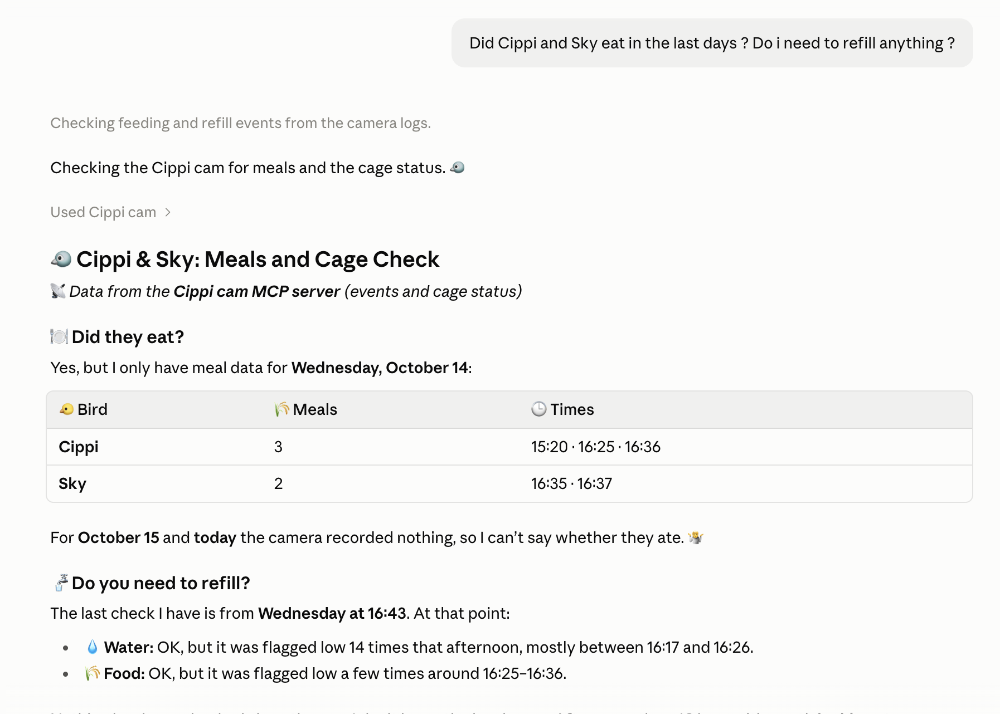
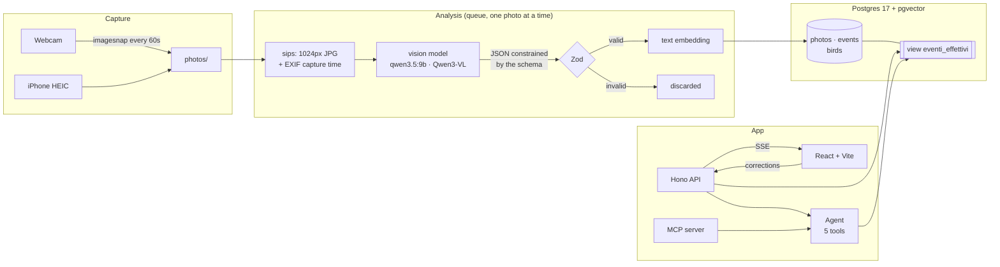
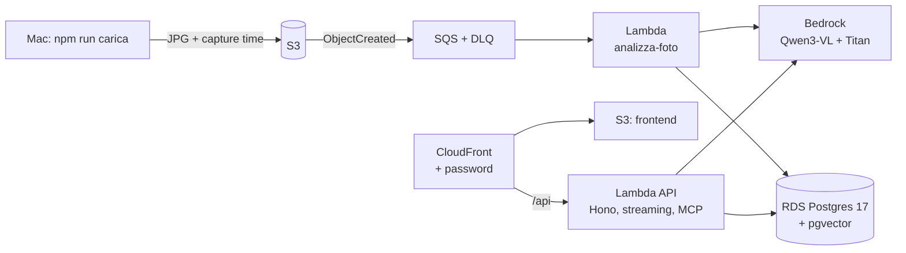

# Cippi Cam

<p align="center">
  
</p>

<table>
  <tr>
    <td align="center" width="40%">
      <br>
      <sub><b>The agent</b>: picks the tools, then answers word by word</sub>
    </td>
    <td align="center" width="60%">
      <br>
      <sub><b>MCP</b>: Claude queries the same diary through the MCP server</sub>
    </td>
  </tr>
</table>

**An automatic diary of two budgies, Cippi and Sky, built with a vision model, structured output validated with Zod, Postgres + pgvector and a LangChain/LangGraph agent with tools. It runs locally with Ollama and moves to AWS (Bedrock, Lambda, RDS) by changing environment variables.**

A webcam takes a photo every minute. A vision model looks at it and says what each bird is doing (eating, drinking, preening, playing, resting…) and, with a second prompt about every 20 minutes, how the cage is doing (water and food). The result is validated, stored in Postgres with an embedding for semantic search, and you can ask about it in a chat: *"how many times did Cippi eat today?"*, *"when was Sky hiding behind the perch?"*, *"is there enough water?"*. The same tools are also exposed as an **MCP server**, so Claude Desktop or claude.ai can query the diary too.

The project started as a hands-on AI engineering exercise. The goal was not a demo that works once, but a **measurable** system: an evaluation set for the vision model and one for the agent, guardrails in code, and honest numbers on where it fails.

> **About the language.** The interface, the agent's answers and this README are in English. The code (file names, identifiers, comments), the prompts, the database values and the model's descriptions are in Italian; the CHANGELOG was translated to English in 0.18.0, while commit messages before that version are in Italian. See the [glossary](#glossary-italian-names-in-the-code).

---

## Contents

- [What it does](#what-it-does)
- [Architecture](#architecture)
- [Technical choices](#technical-choices)
  - [1. Vision with structured output](#1-vision-with-structured-output)
  - [2. The database: SQL and vectors in one place](#2-the-database-sql-and-vectors-in-one-place)
  - [3. The chat agent](#3-the-chat-agent)
  - [4. Streaming with Server-Sent Events](#4-streaming-with-server-sent-events)
  - [5. Live recording and analysis queue](#5-live-recording-and-analysis-queue)
  - [6. Human in the loop: corrections from the gallery](#6-human-in-the-loop-corrections-from-the-gallery)
  - [7. MCP server: the diary for any model](#7-mcp-server-the-diary-for-any-model)
  - [8. Agent observability and evaluation with LangSmith](#8-agent-observability-and-evaluation-with-langsmith)
- [On AWS](#on-aws)
- [Evaluation: the numbers](#evaluation-the-numbers)
- [Lessons learned](#lessons-learned)
- [Stack](#stack)
- [Getting started](#getting-started)
- [Commands](#commands)
- [Project structure](#project-structure)
- [Glossary: Italian names in the code](#glossary-italian-names-in-the-code)
- [Known limitations](#known-limitations)
- [Next steps](#next-steps)

---

## What it does

| Page | What's there |
|---|---|
| **Today** | The day's photo gallery (or the latest day with photos, if there are none today): for each bird the action, the object it interacts with and the confidence; water and food on the photos where the cage was checked. Next to it, the chat with the agent. |
| **Live** | The webcam stream, the **Start recording** button and the photos appearing one by one with their analysis status (queued → the model is looking → result). Local only. |
| **Archive** | Past days with a summary of the actions, and each day's gallery. |
| **Configuration** | Birds, models, database, storage and network, for the local and the AWS setup. |

Across the app:

- **Corrections in the gallery**: confirm ✓ or correct a bird's action. The model's prediction stays stored; your correction becomes the truth for the gallery and the agent, and a label for evaluation. A green or red tag on the photo shows whether the model was right.
- **Streaming chat**: while the agent works you see its steps in grey (tools called, data received, reasoning if any), then the answer is written word by word.
- **Large photo** on click, with descriptions and cage notes.

---

## Architecture



Locally the vision model and the agent are **the same model** (`qwen3.5:9b` in Ollama): with 16 GB of RAM it's better to keep only one in memory. Online they are two Bedrock models (see [On AWS](#on-aws)).

---

## Technical choices

### 1. Vision with structured output

**The Zod schema is the contract** between the model and the rest of the code ([src/modelli/schema.ts](src/modelli/schema.ts)):

```ts
export const EventoUccellino = z.object({
  colore: z.enum(COLORI),                 // the model says the colour, not the name
  posizione: z.string().min(1).max(50),   // position
  postura: z.string().min(1).max(60),     // posture
  con_cosa: z.string().min(1).max(30),    // what it interacts with: "bell", "feeder", "nothing"
  oggetti_vicini: z.array(z.string().max(25)).max(3),
  descrizione: z.string().min(1).max(120),
  azione: z.enum(AZIONI),                 // mangia | beve | dorme | si_pulisce | gioca | vola | riposa | non_visibile
  confidenza: z.number().min(0).max(1),
});
```

The same schema does three jobs:

1. **It constrains the model while it generates.** `z.toJSONSchema()` becomes Ollama's `format` parameter, which turns it into a grammar: at every step the tokens that would break the schema are discarded. The model *cannot* write `"azione": "dancing"`, nor exceed the `max()` lengths.
2. **It checks the answer afterwards.** `safeParse` validates everything again, including rules that don't fit in a grammar (a `.refine()` forbids two birds with the same colour).
3. **It gives TypeScript the types** without writing them twice.

Three details that made a difference:

- **The code assigns the name, not the model.** In the first versions the model saw the colours well but swapped Cippi and Sky. Now it only answers `"giallo"` (yellow) or `"celeste"` (light blue), and [config/uccellini.json](config/uccellini.json) maps colour to name deterministically. Adding a bird is one line of JSON.
- **Observe first, then classify.** With structured output the fields are generated in schema order, so position, posture, object and description come *before* action and confidence. What the model has just written enters its context and steers the choice of action.
- **Length limits in the grammar.** The `.max()` limits stop the model from rambling: about 14% fewer tokens per photo, so less time, with the guarantee that it can't overflow.

### 2. The database: SQL and vectors in one place

Postgres 17 with the **pgvector** extension, in Docker locally and on RDS online ([db/init.sql](db/init.sql), [db/migrazioni/](db/migrazioni/)):

```
uccellini (nome, colore)                                   birds
foto      (id, ora, percorso, modello, scena, acqua, cibo,  photos
           note_gabbia, embedding_immagine)
eventi    (id, foto_id, uccellino, azione, confidenza,      one row per bird per photo
           descrizione, posizione, postura, con_cosa, oggetti_vicini,
           embedding_testo vector(768 | 1024), azione_umana, controllato_il)
```

- **One row per bird per photo**, so questions are plain SQL (`COUNT`, `GROUP BY`, filters on date and name).
- **`embedding_testo`** with an HNSW index for semantic search over the descriptions (*"near the mirror"*, *"hiding"*): 768 dimensions with `nomic-embed-text` locally, 1024 with Titan on AWS.
- **`embedding_immagine`**: the CLIP fingerprint of each photo (512 numbers, [src/modelli/immagini.ts](src/modelli/immagini.ts)), computed in ~30 ms at import with transformers.js and a Hugging Face model. It powers search directly in the photos (`npm run cerca -- --immagini`) and "similar photos". Local only.
- **Hybrid search**: pgvector cosine similarity plus SQL filters in the same query (`WHERE uccellino = 'Sky' ORDER BY embedding <=> $1`).
- **View `eventi_effettivi`**: defines in one place "what the truth is" (the human correction if there is one, otherwise the model). Every read goes through it.
- **Episodes**: with one photo a minute, "Cippi eats for 5 minutes" is 5 events but **one** episode. [src/agente/episodi.ts](src/agente/episodi.ts) merges consecutive events, so the counts make sense.
- **Re-runnable migrations** (`npm run db:migra`): every file in `db/migrazioni/` can be applied more than once without errors.

Why Postgres and not a dedicated vector DB: the data is mostly **structured** (actions, times, names), and it needs both exact filters and similarity. Keeping them in the same table allows hybrid queries without syncing two systems.

### 3. The chat agent

[src/agente/](src/agente/): a **LangChain** agent (`createAgent`) running on a **LangGraph** graph. The model gets the question and five tools, decides which to call, reads the results and answers in the language of the question.

```
            ┌──────────── middleware: wrapModelCall ────────────┐
question ─► │ model: answer or call a tool?                      │ ──tool──► wrapToolCall ──► tool ──┐
            │  · system prompt with today's date                 │                                    │
            │  · guardrail: numbers without a tool → retry       │ ◄────────── back to the model ◄────┘
            └────────────────────────────────────────────────────┘ ──answer──► done
```

| File | What it contains |
|---|---|
| [strumenti.ts](src/agente/strumenti.ts) | the 5 tools, defined with `tool()` and a Zod schema (the equivalent of Python's `@tool`) |
| [middleware.ts](src/agente/middleware.ts) | the rules hooked into the loop: prompt with the date, guardrail, argument clean-up |
| [prompt.ts](src/agente/prompt.ts) | the system prompt |
| [index.ts](src/agente/index.ts) | `createAgent` and the translation of the LangGraph stream into chat events |

| Tool | Under the hood | For questions like |
|---|---|---|
| `eventi_del_giorno` | SQL + episodes | "what did Sky do today?", "what was happening at 16:26?" |
| `conta_eventi` | SQL + episodes | "how many times did Cippi eat?" |
| `cerca_momenti` | pgvector + SQL filters | "when was Sky hiding?" |
| `stato_gabbia` | SQL, with precomputed periods | "is there enough water?", "when was the food low?" |
| `momenti_insieme` | overlap of the two birds' episodes | "did they play together?" |

The guardrails live **in the code, not only in the prompt**:

- **Tool arguments validated with Zod** before touching the database. If the model invents a bird or passes a wrong date, it gets the error back and corrects itself (it really happens, and it's in the logs).
- **An answer with numbers but no tool call = discarded.** Sometimes the model answers from memory and makes up times. A `wrapModelCall` middleware checks the answer and, if suspicious, **repeats the same call with the "reasoning" model**, only for that question. The discarded answer never enters the conversation. If it fails again, the agent says it couldn't look it up instead of inventing.
- **Precomputed summaries** in the tools: a model gets it wrong if it has to infer "water was low from 16:17 to 16:26" from a list of 30 values, so the tool hands it the intervals directly. When the agent got questions wrong, the fix was almost always in the tool, not in the prompt.

#### Interchangeable providers: Ollama or Bedrock

[src/modelli/llm.ts](src/modelli/llm.ts) is the only place that knows which provider is in use. The rest of the code asks for "the chat model", "the vision model", "the embeddings" and gets LangChain objects with the same interface:

```bash
LLM_PROVIDER=ollama     # default: qwen3.5:9b + nomic-embed-text locally
LLM_PROVIDER=bedrock    # Amazon Bedrock: AWS_REGION, VISION_MODEL, AGENT_MODEL, EMBED_MODEL
```

Variables live in `.env` (see [.env.example](.env.example)); the AWS SDK finds the credentials (SSO, profile, IAM role), never the code. One constraint: **embeddings from different models have different sizes** and aren't comparable, so changing `EMBED_MODEL` needs a migration. At start-up `controllaEmbedding()` compares the model with the database column and stops with a clear message instead of storing incompatible vectors.

**One measured exception: vision on Ollama doesn't go through LangChain.** `@langchain/ollama` (1.3.0) turns a "text + image" message into two separate messages, and for `qwen3.5:9b` that's a different input: on the same 32 labels, 15 correct answers with one message against 8 with two. So `classifyImage()` on Ollama sends the request directly (text and image together, `format` = Zod schema), while on Bedrock it uses `withStructuredOutput`.

### 4. Streaming with Server-Sent Events

The chat uses **SSE** on `POST /api/chat/stream` ([src/server/app.ts](src/server/app.ts)):

```
model ──tokens──► LangGraph stream("messages" + "updates") ──► chat events ──SSE──► browser
```

- **Reasoning** chunks go to the browser right away.
- **Answer** chunks are streamed **only after a tool has been used**. An answer without tools is held back until the guardrail has checked it, so a made-up answer never shows up, not even for an instant.
- On the React side every event goes through a **pure reducer** (`applica(message, event)`) inside a functional `setState`. It's immutable, so it's safe even with StrictMode's double invocation.
- Online, the API Lambda uses **response streaming**, so the answer arrives word by word there too.

The Live page uses the native `EventSource` on `GET /api/scatti/stream`, which reconnects by itself if the server restarts.

### 5. Live recording and analysis queue

[src/server/registrazione.ts](src/server/registrazione.ts): the Live page starts a recording that runs **on the server**, not in the browser (a background tab would slow down the timers).

```
every 60s:  capture → photos/cam_….jpg ──► queue ──► worker (one photo at a time)
                                                     convert → model → Zod → embedding → DB
```

- **Capturing never waits for the analysis**: if the model is slow, the queue grows and then catches up.
- `caffeinate` keeps the Mac awake, tied to the server process.
- Capture, analysis and queue are separate modules ([src/foto/webcam.ts](src/foto/webcam.ts), [src/foto/importazione.ts](src/foto/importazione.ts)) that map one to one onto the AWS version: S3, SQS, Lambda.

### 6. Human in the loop: corrections from the gallery

- The **model's prediction is never overwritten**: the correction goes into `azione_umana`, next to it.
- **Confirming** counts as much as correcting: without confirmations the evaluation set would only contain errors.
- A correction immediately updates the gallery and the agent (through the view) and **recomputes the embedding**, whose text contains the action.
- Corrections become **labels** for `npm run valuta`.
- The same goes for **water and food** (`acqua_umana`, `cibo_umano`, view `foto_effettive`), with only two levels tied to a decision: `ok` / `da_rifornire` (needs refill), plus `non_visibile`.
- **The cage has its own prompt** (`classifyGabbia` in `src/modelli/modelli.ts`), separate from the actions one: food rules in a single prompt made the actions worse. It doesn't run on every photo: every `GABBIA_OGNI_MIN` minutes (20), or after `GABBIA_RICONTROLLO_MIN` (5) if the last check said `da_rifornire`, so a future alert only fires on a confirmed problem.

### 7. MCP server: the diary for any model

[src/server/mcp.ts](src/server/mcp.ts) exposes the agent's five tools through the **Model Context Protocol**: Claude Desktop, Claude Code, claude.ai or any MCP client can query the diary with the same tools as the chat.

- **No duplicated code**: LangChain tools already have a name, a description and a Zod schema, so the server registers them in a loop. A change to a tool applies to both the chat and MCP.
- **The server doesn't reason**: it answers `tools/list` and `tools/call`. Which tool to use is decided by the client's model, just like Qwen in the chat. So you can compare how two different models use the same tools.
- **stdio transport** ([src/comandi/mcp.ts](src/comandi/mcp.ts)): the client starts the process and talks JSON-RPC over stdin/stdout. That's why [mcp-avvio.ts](src/comandi/mcp-avvio.ts) sends all logs to stderr and moves the working directory to the project root (the client starts it from anywhere).
- **Remote MCP** (Streamable HTTP) on `/api/mcp/<token>` of the API Lambda, for **claude.ai** custom connectors (web and phone). It's *stateless*, because on Lambda each request can land on a different instance. It's protected by a **private link**: a 40-character token in the URL (`terraform output -raw mcp_url`), a wrong token gets a 404, and the tools are read-only. Revoke it with `terraform apply -replace=random_password.mcp`.
- `npm run mcp:prova` is a minimal client: it starts the server, lists the tools and calls two of them (`--url` for the remote one).

**Claude Code** finds it by itself: [.mcp.json](.mcp.json) in the project root declares it with relative paths (on first use it asks whether to trust the server). **Claude Desktop** needs absolute paths to `node` and `tsx` (with nvm they aren't on its PATH):

```jsonc
// ~/Library/Application Support/Claude/claude_desktop_config.json
{
  "mcpServers": {
    "cippi-cam": {
      "command": "/Users/<user>/.nvm/versions/node/v20.20.2/bin/node",
      "args": ["/path/to/cippi-cam/node_modules/tsx/dist/cli.mjs", "/path/to/cippi-cam/src/comandi/mcp.ts"],
      // For the diary on AWS instead of Docker (the AWS profile needs rds-db:connect):
      "env": { "DB_PROVIDER": "rds", "LLM_PROVIDER": "bedrock", "EMBED_MODEL": "amazon.titan-embed-text-v2:0", "AWS_PROFILE": "cippi" }
    }
  }
}
```

### 8. Agent observability and evaluation with LangSmith

With `LANGSMITH_TRACING=true` in `.env`, LangChain and LangGraph send LangSmith (project `cippi-cam`) a trace of every question: model calls, chosen tools with arguments and results, tokens and timings.

- **The photos stay home**: vision calls on Bedrock use their own tracer ([src/modelli/tracce.ts](src/modelli/tracce.ts)) that replaces base64 images with `[immagine]`. Prompt, answer and tokens stay in the trace.
- **`npm run valuta-agente`** is `valuta` for the chat. The questions live in [eval/agente.json](eval/agente.json) (Italian) and [eval/agente-en.json](eval/agente-en.json) (English), versioned in git, and are synced to LangSmith datasets. Every run is an **experiment** (Datasets & Experiments), comparable with the others question by question.
- **Evaluators in code**, not an LLM judge: `tool_giusti` (did it call the expected tools?) and `risposta_giusta` (does the answer contain the expected numbers and times, and nothing it shouldn't say?). Deterministic and free.

---

## On AWS

Since 0.14.0 the diary also runs online (region `eu-south-1`, Milan), with the infrastructure in Terraform ([infra/](infra/)). No EC2: compute is all Lambda, and the only always-on piece is the database.



| Local | AWS |
|---|---|
| `photos/` folder | S3 (photos are uploaded by `npm run carica`: the webcam stays on the Mac) |
| in-memory queue | SQS, 3 attempts then a dead letter queue |
| `importaFoto()` | `importaJpg()` inside the `analizza-foto` Lambda |
| Ollama (`qwen3.5:9b`, `nomic-embed-text`) | Bedrock: Qwen3-VL 235B (vision), Qwen3 235B (chat), Titan v2 (embeddings, 1024 dims) |
| Postgres in Docker | RDS Postgres `db.t4g.micro`: SSL and IAM-token login, no password for the app |
| Hono server | the same `app.ts` in a Lambda with a Function URL and response streaming |

Choices worth knowing:

- **Lambdas outside the VPC.** Inside, they'd need a NAT Gateway (~35 $/month) to reach Bedrock and S3. RDS is therefore reachable on 5432, but getting in requires SSL and a signed IAM token: the `diario` user has no password.
- **RDS instead of Aurora Serverless.** Aurora would pause by itself, but on the AWS free plan it can only be created in "express configuration", which Terraform doesn't support yet.
- **Models chosen by measuring** (`valuta`), not by default: see the numbers below.
- **Fixed cost** ~4 $/month (RDS public IPv4 + the master secret); Lambda, S3, SQS and CloudFront stay within the free tier at this traffic; Bedrock is pay-per-token (~0.002 $ per analysed photo).

The reasoning behind each choice is in the comments of the `.tf` files and in the [CHANGELOG](CHANGELOG.md) for 0.14.0.

---

## Evaluation: the numbers

Every change to a prompt, a tool or a model is measured before and after.

**Vision models** (`npm run valuta`, 57 labelled photos, same prompt):

| | qwen3.5:9b local | **Qwen3-VL 235B** (Bedrock) | Nova 2 Lite (Bedrock) |
|---|---|---|---|
| actions (101 labels) | 65% | **56%** | 50% |
| water (36) | 56%* | 39% | 39% |
| food (31) | 90% | **94%** | 74% |
| time per photo | ~40 s | ~4 s | ~3 s |

\* measured on 27 water labels. Water is the weak spot for every model: the errors are almost symmetric, which points at the framing of the photo more than at the model.

**Agent** (`npm run valuta-agente`, 14 questions in Italian and the same 14 in English, Qwen3 235B on Bedrock, diary on RDS), 1–3 s per question:

| | right tools | right answers |
|---|---|---|
| Italian | 14/14 | 13/14 |
| English | 13/14 | 14/14 |

The three questions it got wrong before 0.14.0 (water and food low together, playing together, "at 16:26") now pass. The remaining failures come from two tools, not from the model (see CHANGELOG 0.17.0). The answer language is decided in code: with the rule only in the prompt, English questions about an empty day got Italian answers (see CHANGELOG 0.18.0).

**Earlier experiments on the local classifier** (12 photos, 24 labels):

| Variant | Accuracy | Tokens per photo | Notes |
|---|---|---|---|
| Prompt with visual cues (head, beak) | **63%** | 424 | baseline |
| Prompt with short fields + examples | 38% | 363 | the model **copies the examples** (see below) |
| `qwen3-vl:8b` instead of `qwen3.5:9b` | worse | ~4000 | repetition loops, ~8× slower |
| 1536px instead of 1024px | unchanged | — | slower, no gain |

**Embedding models** for semantic search ([eval/ricerca.json](eval/ricerca.json), `npm run confronta-embedding`):

| Model | hit@1 | MRR | Time |
|---|---|---|---|
| **nomic-embed-text** (chosen) | 3/4 | 0.88 | 0.2s |
| bge-m3 | 3/4 | 0.88 | 1.5–7s |
| qwen3-embedding:0.6b | 2/4 | 0.75 | 5.5s |

---

## Lessons learned

- **The model's stated confidence isn't reliable.** It said "Sky not visible" with 0.95, and Sky was there. Confidence is a number the model *writes*, not a probability.
- **An example in the prompt becomes an answer.** Using "beak in the wing feathers" as a posture example dropped accuracy from 63% to 38%: the model copied it even when it didn't fit, and the copied posture pushed it towards "preening".
- **A small model's prompt is fragile.** Adding *one* rule ("don't use markdown") made the agent stop using tools: it invented times. Hence the choice to put the defences in code (validation, rejecting answers without tools) and handle markdown in the interface.
- **When the agent is wrong, look at the tools first.** Answers like "water and food were never low together" came from a tool that returned counts instead of time periods. Giving the tool the right summary fixed it; a longer prompt wouldn't have.
- **"Thinking" models need care.** `qwen3:4b` always reasons: ~600 tokens to decide to call a tool, so 45–110 seconds per question. An agent works better with a model whose reasoning can be switched off and on only when needed.
- **The photos matter more than the model.** Birds behind the bars, with the head hidden by the feeder, are ambiguous even for a human. Moving the webcam closer improved results more than any prompt change.
- **Measure before changing.** Without `valuta` the "improved" prompt would have shipped with half the accuracy.

---

## Stack

| Layer | Technology |
|---|---|
| Models | [Ollama](https://ollama.com) · `qwen3.5:9b` · `nomic-embed-text` locally; Amazon Bedrock · Qwen3-VL 235B · Qwen3 235B · Titan v2 online |
| Orchestration | [LangChain.js](https://js.langchain.com) (`createAgent`, `tool`, middleware, `withStructuredOutput`) · [LangGraph.js](https://langchain-ai.github.io/langgraphjs/) |
| Tools for other models | [Model Context Protocol](https://modelcontextprotocol.io) (stdio and Streamable HTTP) |
| Observability and evals | [LangSmith](https://smith.langchain.com) |
| Validation | [Zod 4](https://zod.dev): schema → JSON Schema → model grammar |
| Database | Postgres 17 + [pgvector](https://github.com/pgvector/pgvector) (HNSW), Docker locally, RDS online |
| Backend | Node · TypeScript · [Hono](https://hono.dev) · SSE |
| Frontend | React 19 · Vite · React Router 7 |
| Cloud | AWS (S3, SQS, Lambda, Bedrock, RDS, CloudFront) with [Terraform](https://www.terraform.io) |
| Capture | `imagesnap` (webcam) · `sips` (HEIC → JPG) · `exifr` (capture time) |

---

## Getting started

Requirements: macOS (for `imagesnap`, `sips`, `caffeinate`), Node 20+, Docker, [Ollama](https://ollama.com).

```bash
# dependencies
npm install && (cd web && npm install)
brew install imagesnap

# models
ollama pull qwen3.5:9b
ollama pull nomic-embed-text

# database (first time)
npm run db:up        # Postgres 17 + pgvector
npm run db:migra     # applies db/migrazioni/ (re-runnable)

# everything together: Postgres + API + interface
npm run dev
```

`npm run dev` ([scripts/dev.mjs](scripts/dev.mjs)) starts Postgres if it's off, runs the API and the interface with prefixed output (`[api]`, `[web]`), and **Ctrl+C** stops everything. Then open **http://localhost:5173**.

The birds are configured in [config/uccellini.json](config/uccellini.json):

```json
[
  { "nome": "Cippi", "colore": "giallo" },
  { "nome": "Sky", "colore": "celeste" }
]
```

---

## Commands

| Command | What it does |
|---|---|
| `npm run dev` | Postgres + API + interface together; Ctrl+C stops everything |
| `npm run server` | API only on `localhost:3001/api` (in watch mode: for long recordings use `npx tsx src/server/index.ts`) |
| `cd web && npm run dev` | interface only on `localhost:5173` |
| `npm run importa` | converts new photos in `photos/` (HEIC too), reads the capture time, classifies and saves |
| `npm run importa -- photos/X.HEIC` | imports only the given files (also `--lista list.txt`, one photo per line) |
| `npm run scatta -- --ogni 60 --durata 60` | webcam photos into `photos/` (same as the Live page) |
| `npm run classify -- data/foto/X.jpg --dry-run` | analyses one photo without saving it |
| `npm run chiedi -- "how many times did Cippi eat?"` | asks the agent from the terminal, with the tool trace |
| `npm run cerca -- "Sky hiding"` | semantic search over the descriptions |
| `npm run cerca -- --immagini "two budgies near the feeder"` | searches the photos directly (CLIP, in English) |
| `npm run cerca -- --simili 12` | the photos most similar to photo #12 |
| `npm run embedding-immagini` | computes the CLIP fingerprint for photos that don't have one |
| `npm run valuta` | re-classifies the labelled photos and measures accuracy (`--foto NAME`, `--lato 1536`) |
| `npm run valuta -- --salvate` | saved predictions against your labels (actions, water, food), without calling the model |
| `npm run valuta-agente` | measures the agent on `eval/agente.json` (`--file eval/agente-en.json` for English) and creates a LangSmith experiment |
| `npm run confronta-embedding -- nomic-embed-text bge-m3` | compares embedding models on `eval/ricerca.json` |
| `npm run db:up` / `db:migra` / `db:psql` | starts Postgres, applies the migrations, opens the SQL console |
| `npm run carica` | AWS: converts and uploads the photos in `photos/` to S3; the analysis starts by itself |
| `npm run build:lambda` | AWS: bundles the Lambdas into `infra/build/` (before `terraform plan`) |
| `npm run db:migra:aws` | AWS: schema, migrations, birds and the `diario` user on RDS (re-runnable) |
| `npm run deploy:web` | AWS: builds the online frontend and publishes it to S3 + CloudFront |
| `npm run copia-correzioni` | AWS: copies the gallery corrections from local Postgres to RDS |
| `npm run mcp:prova` | tests the MCP server: starts it, lists the tools and calls two (`--url` for the remote one) |

Environment variables: see [.env.example](.env.example) (`LLM_PROVIDER`, `VISION_MODEL`, `AGENT_MODEL`, `EMBED_MODEL`, `DB_PROVIDER`, `AWS_REGION`, `LANGSMITH_*`…). Put them in `.env` or in front of the command (`LLM_PROVIDER=bedrock npm run valuta`).

---

## Project structure

```
config/uccellini.json        who lives in the cage (name ↔ colour)
db/
  init.sql                   initial schema
  migrazioni/                human corrections, details, image index, cage levels
eval/                        hand labels and questions with expected answers, for the measurements
infra/                       Terraform: network, RDS, S3, SQS, Lambda, CloudFront
scripts/                     dev.mjs (local start-up), build-lambda.mjs, deploy-web.mjs
src/
  comandi/                   what "npm run …" launches: importa, scatta, classify, valuta, valuta-agente,
                             cerca, chiedi, confronta-embedding; carica, migra-aws, copia-correzioni (AWS);
                             mcp and mcp-prova
  server/                    the Hono API (app.ts shared with Lambda, index.ts local), MCP server, Live recording
  aws/                       the two Lambda handlers (API, photo analysis)
  foto/                      from webcam to diary: webcam.ts, importazione.ts (one photo), s3.ts, pipeline.ts
  modelli/                   everything that talks to a model: llm.ts (Ollama/Bedrock factory), modelli.ts
                             (vision + text embeddings), immagini.ts (CLIP), schema.ts (Zod contract), tracce.ts
  agente/                    the LangChain/LangGraph chat: tools, middleware (guardrail), prompt, episodes
  db/                        db.ts: every query (the rest of the code doesn't know it's Postgres); connessione.ts
  comune/                    env.ts (.env), uccellini.ts, api-types.ts (types shared with the frontend), terminale.ts
web/src/
  pages/                     Today, Live, Archive, Configuration, Credits
  components/                Gallery (corrections, large photo), Chat (streaming, trace)
  api.ts                     API client, SSE streams, English labels for actions and levels
```

---

## Glossary: Italian names in the code

| Italian | English | | Italian | English |
|---|---|---|---|---|
| uccellino | bird | | mangia | eats |
| gabbia | cage | | beve | drinks |
| acqua / cibo | water / food | | dorme | sleeps |
| foto / scatto | photo / shot | | si_pulisce | preens |
| evento / episodio | event / episode | | gioca | plays |
| azione | action | | vola | flies |
| diario | diary | | riposa | rests |
| correzione | correction | | non_visibile | not visible |
| strumenti | tools | | da_rifornire | needs refill |
| valuta | evaluate | | giallo / celeste | yellow / light blue |

---

## Known limitations

- **Modest accuracy on the hard actions**, with photos taken through the bars: 56% on actions with Qwen3-VL online, and water around 40% for every model tried.
- **A photo is an instant**: "preening" and "resting" can look identical in one frame. The classifier alternates actions from one shot to the next and breaks episodes.
- **The model's descriptions are in Italian** (the vision prompt is): the interface translates actions and levels, not the free text.
- **Live recording state lives in the server process**: if the server restarts, the recording stops.
- **macOS only** for capture (`imagesnap`, `sips`, `caffeinate`).
- **Simple access control online**: one shared password (Basic Auth) for the site and a private link for the remote MCP. Fine for a demo; a real product would use proper accounts and OAuth.

---

## Next steps

- [x] **Abstract provider** (Ollama | Bedrock) with LangChain, chosen via env.
- [x] The same `npm run valuta` on Ollama and Bedrock (0.14.0): Qwen3-VL actions 56% vs 65% locally, ~4 s per photo vs ~40 s.
- [x] **Online on AWS** with Terraform (0.14.0), **MCP** local and remote (0.15–0.16), **LangSmith** traces and agent evals (0.17).
- [ ] Fix the two tools found by `valuta-agente` (time after the last cage check; "while one bird does X").
- [ ] **Majority vote** over consecutive shots, to stabilise actions and episode counts.
- [ ] **Visual few-shot** with gallery corrections as examples in the prompt.
- [ ] Tracing on the chat Lambda, and 👍/👎 feedback from the chat into LangSmith.
- [ ] An alert when water or food is low.
