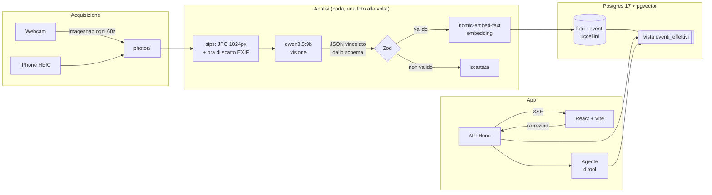
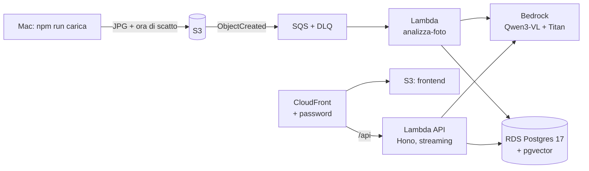

# Cippi Cam

**Un diario automatico di due pappagallini, Cippi e Sky, costruito con un modello di visione, output strutturato validato con Zod, Postgres + pgvector e un agente LangChain/LangGraph con tool. Gira in locale con Ollama, e passa ad Amazon Bedrock cambiando una variabile d'ambiente.**

Una webcam scatta una foto al minuto. Un modello di visione locale guarda la foto, dice cosa sta facendo ciascun uccellino (mangia, beve, si pulisce, gioca, riposa…) e, con un secondo prompt ogni 20 minuti circa, com'è la gabbia (acqua e cibo). Il risultato viene validato, salvato in Postgres con un embedding per la ricerca semantica, e si può interrogare in chat: *"quante volte ha mangiato Cippi oggi?"*, *"quando Sky era nascosto dietro il posatoio?"*, *"c'è abbastanza acqua?"*.

Il progetto è nato come esercizio pratico di AI engineering. L'obiettivo non era una demo che funziona una volta, ma un sistema **misurabile**: con un set di valutazione, guardrail nel codice e numeri onesti su dove sbaglia.

---

## Indice

- [Cosa fa](#cosa-fa)
- [Architettura](#architettura)
- [Le scelte tecniche](#le-scelte-tecniche)
  - [1. Visione con output strutturato](#1-visione-con-output-strutturato)
  - [2. Il database: SQL e vettori nello stesso posto](#2-il-database-sql-e-vettori-nello-stesso-posto)
  - [3. L'agente della chat](#3-lagente-della-chat)
  - [4. Streaming con Server-Sent Events](#4-streaming-con-server-sent-events)
  - [5. Registrazione live e coda di analisi](#5-registrazione-live-e-coda-di-analisi)
  - [6. Human-in-the-loop: correzioni dalla galleria](#6-human-in-the-loop-correzioni-dalla-galleria)
- [Valutazione: i numeri](#valutazione-i-numeri)
- [Lezioni imparate](#lezioni-imparate)
- [Stack](#stack)
- [Avvio](#avvio)
- [Comandi](#comandi)
- [Struttura del progetto](#struttura-del-progetto)
- [Limiti noti](#limiti-noti)
- [Su AWS](#su-aws)

---

## Cosa fa

| Pagina | Cosa c'è |
|---|---|
| **Oggi** | Galleria delle foto del giorno: per ogni uccellino azione, oggetto con cui interagisce e confidenza; acqua e cibo della gabbia sulle foto in cui è stata controllata. Accanto, la chat con l'agente. |
| **Live** | Il video della webcam in diretta, il pulsante **Avvia registrazione** e gli scatti che compaiono man mano, con lo stato dell'analisi (in coda → il modello sta guardando → risultato). |
| **Archivio** | I giorni passati, con il riepilogo delle azioni, e la galleria di ciascun giorno. |
| **Configurazione** | Uccellini, modelli, database, storage e rete, in versione locale e (in preparazione) AWS. |

Funzioni trasversali:

- **Correzione in galleria**: confermi ✓ o correggi l'azione di un uccellino. La previsione del modello resta salvata, la tua correzione diventa la verità per galleria e agente, e un'etichetta per la valutazione. Sulla foto, un'etichetta verde o rossa mostra se il modello aveva ragione.
- **Chat in streaming**: mentre l'agente lavora vedi in grigio i passaggi (tool chiamati, dati ricevuti, eventuale ragionamento), poi la risposta che si scrive parola per parola.
- **Foto grande** al click, con descrizioni e note sulla gabbia.

---

## Architettura



Il modello di visione e l'agente sono **lo stesso modello** (`qwen3.5:9b` in Ollama): con 16 GB di RAM conviene tenerne in memoria uno solo.

---

## Le scelte tecniche

### 1. Visione con output strutturato

**Lo schema Zod è il contratto** tra il modello e il resto del codice ([src/modelli/schema.ts](src/modelli/schema.ts)):

```ts
export const EventoUccellino = z.object({
  colore: z.enum(COLORI),                 // il modello dice il colore, non il nome
  posizione: z.string().min(1).max(50),
  postura: z.string().min(1).max(60),
  con_cosa: z.string().min(1).max(30),    // "campanellino", "mangiatoia", "niente"
  oggetti_vicini: z.array(z.string().max(25)).max(3),
  descrizione: z.string().min(1).max(120),
  azione: z.enum(AZIONI),                 // mangia | beve | dorme | si_pulisce | gioca | vola | riposa | non_visibile
  confidenza: z.number().min(0).max(1),
});
```

Lo stesso schema serve a tre cose:

1. **Vincola il modello mentre genera.** `z.toJSONSchema()` diventa il parametro `format` di Ollama, che lo trasforma in una grammatica: a ogni token vengono scartati quelli che violerebbero lo schema. Il modello non *può* scrivere `"azione": "balla"`, né superare i `max()` di lunghezza.
2. **Controlla la risposta dopo.** `safeParse` ricontrolla tutto, comprese le regole che nella grammatica non entrano (un `.refine()` vieta due uccellini con lo stesso colore).
3. **Dà i tipi a TypeScript** senza riscriverli.

Tre dettagli che hanno fatto la differenza:

- **Il nome lo assegna il codice, non il modello.** Nelle prime versioni il modello vedeva bene i colori ma scambiava Cippi e Sky. Ora risponde solo `"giallo"` o `"celeste"`, e [config/uccellini.json](config/uccellini.json) traduce in nome in modo deterministico. Per aggiungere un uccellino basta una riga nel JSON.
- **Prima osserva, poi classifica.** Con l'output strutturato i campi vengono generati nell'ordine dello schema, quindi posizione, postura, oggetto e descrizione vengono *prima* di azione e confidenza. Quello che il modello ha appena scritto entra nel contesto e orienta la scelta dell'azione.
- **Limiti di lunghezza nella grammatica.** I `.max()` impediscono al modello di dilungarsi: circa il 14% di token in meno a foto, e quindi meno tempo, con la garanzia che non può sforare.

### 2. Il database: SQL e vettori nello stesso posto

Postgres 17 con l'estensione **pgvector**, in Docker ([db/init.sql](db/init.sql), [db/migrazioni/](db/migrazioni/)):

```
uccellini (nome, colore)
foto      (id, ora, percorso, modello, scena, acqua, cibo, note_gabbia, embedding_immagine)
eventi    (id, foto_id, uccellino, azione, confidenza, descrizione, posizione, postura,
           con_cosa, oggetti_vicini, embedding_testo vector(768), azione_umana, controllato_il)
```

- **Una riga per uccellino per foto**, così le domande sono SQL normale (`COUNT`, `GROUP BY`, filtri per data e nome).
- **`embedding_testo`** con indice HNSW per la ricerca semantica sulle descrizioni (*"vicino allo specchio"*, *"nascosto"*).
- **`embedding_immagine`**: l'impronta CLIP di ogni foto (512 numeri, [src/modelli/immagini.ts](src/modelli/immagini.ts)), calcolata in ~30 ms durante l'import con transformers.js e un modello di Hugging Face. Serve a cercare direttamente nelle foto (`npm run cerca -- --immagini`), a trovare foto simili, ed è la base per un futuro classificatore.
- **Ricerca ibrida**: similarità coseno di pgvector più filtri SQL nella stessa query (`WHERE uccellino = 'Sky' ORDER BY embedding <=> $1`).
- **Vista `eventi_effettivi`**: definisce in un solo punto "qual è la verità" (la correzione umana se c'è, altrimenti il modello). Tutte le letture passano da lì.
- **Episodi**: con una foto al minuto, "Cippi mangia per 5 minuti" sono 5 eventi ma **un** episodio. [src/agente/episodi.ts](src/agente/episodi.ts) unisce gli eventi consecutivi, così i conteggi hanno senso.
- **Migrazioni rilanciabili** (`npm run db:migra`): ogni file in `db/migrazioni/` si può applicare più volte senza errori.

Perché Postgres e non un vector DB dedicato: i dati sono soprattutto **strutturati** (azioni, orari, nomi), e servono sia filtri esatti sia similarità. Tenerli nella stessa tabella permette query ibride senza sincronizzare due sistemi. Su AWS diventa RDS, che supporta pgvector.

### 3. L'agente della chat

[src/agente/](src/agente/): un agente **LangChain** (`createAgent`) che gira su un grafo **LangGraph**. Il modello riceve la domanda e quattro tool, decide quali chiamare, legge i risultati e risponde.

```
            ┌──────────── middleware: wrapModelCall ────────────┐
domanda ──► │ modello: risponde o chiama un tool?                │ ──tool──► wrapToolCall ──► tool ──┐
            │  · promptDelGiorno: system prompt con la data      │                                    │
            │  · guardrail: numeri senza tool → riprova ragionando│ ◄──────────── torna al modello ◄───┘
            └────────────────────────────────────────────────────┘ ──risposta──► fine
```

| File | Cosa contiene |
|---|---|
| [strumenti.ts](src/agente/strumenti.ts) | i 4 tool, definiti con `tool()` e uno schema Zod (l'equivalente del `@tool` di Python) |
| [middleware.ts](src/agente/middleware.ts) | le regole agganciate al ciclo: prompt con la data, guardrail, pulizia degli argomenti |
| [prompt.ts](src/agente/prompt.ts) | il system prompt |
| [index.ts](src/agente/index.ts) | `createAgent` e la traduzione dello stream di LangGraph negli eventi della chat |

| Tool | Sotto | Per domande tipo |
|---|---|---|
| `eventi_del_giorno` | SQL + episodi | "cosa ha fatto Sky oggi?" |
| `conta_eventi` | SQL + episodi | "quante volte ha mangiato Cippi?" |
| `cerca_momenti` | pgvector + filtri SQL | "quando Sky era nascosto?" |
| `stato_gabbia` | SQL, con riassunto già calcolato | "c'è abbastanza acqua?" |

I guardrail stanno **nel codice, non solo nel prompt**:

- **Argomenti dei tool validati con Zod** prima di toccare il database. Se il modello inventa un uccellino o passa una data sbagliata, riceve l'errore e si corregge (succede davvero, ed è nei log).
- **Risposta con numeri senza aver usato un tool = scartata.** Il modello a volte risponde a memoria inventando orari. Un middleware `wrapModelCall` guarda la risposta e, se è sospetta, **ripete la stessa chiamata con il modello "ragionante"** (`think: true`), solo per quella domanda. La risposta scartata non entra mai nella conversazione. Se fallisce di nuovo, l'agente dice che non è riuscito a consultare il diario invece di inventare.
- **Riassunti già calcolati** nei tool: un modello piccolo sbaglia se deve dedurre "l'acqua è sufficiente" da una lista di 30 valori, quindi il tool gli passa direttamente `ultimo_livello_visto`.

### Provider intercambiabili: Ollama o Bedrock

[src/modelli/llm.ts](src/modelli/llm.ts) è l'unico punto che sa quale provider stiamo usando. Il resto del codice chiede "il modello della chat", "il modello di visione", "gli embedding", e riceve oggetti LangChain con la stessa interfaccia:

```bash
LLM_PROVIDER=ollama     # default: qwen3.5:9b + nomic-embed-text in locale
LLM_PROVIDER=bedrock    # Amazon Bedrock: AWS_REGION, VISION_MODEL, AGENT_MODEL, EMBED_MODEL
```

Le variabili stanno in `.env` (vedi [.env.example](.env.example)); le credenziali AWS le trova l'SDK (SSO, profilo, ruolo IAM), mai nel codice. Unico vincolo: **gli embedding di modelli diversi hanno dimensioni diverse** e non sono confrontabili, quindi cambiare `EMBED_MODEL` richiede una migrazione. All'avvio `controllaEmbedding()` confronta il modello con la colonna del database e si ferma con un messaggio chiaro, invece di salvare vettori incompatibili.

**Un'eccezione misurata: la visione su Ollama non passa da LangChain.** `@langchain/ollama` (1.3.0) trasforma un messaggio "testo + immagine" in due messaggi separati, e per `qwen3.5:9b` è un input diverso: sulle stesse 32 etichette, 15 risposte giuste con un messaggio solo contro 8 con due. Quindi `classifyImage()` su Ollama manda la richiesta direttamente (testo e immagine insieme, `format` = schema Zod), mentre su Bedrock usa `withStructuredOutput`. L'agente invece resta tutto LangChain: misurato identico alla versione precedente.

### 4. Streaming con Server-Sent Events

La chat usa **SSE** su `POST /api/chat/stream` ([src/server/index.ts](src/server/index.ts)):

```
modello ──token──► LangGraph stream("messages" + "updates") ──► eventi della chat ──SSE──► browser
```

- I pezzi di **ragionamento** vanno subito al browser.
- I pezzi di **risposta** vanno in streaming **solo dopo che è stato usato un tool**. Una risposta senza tool resta trattenuta finché il guardrail non l'ha controllata, così una risposta inventata non compare mai, nemmeno per un istante.
- Lato React, ogni evento passa da un **reducer puro** (`applica(messaggio, evento)`) dentro un `setState` funzionale. È immutabile e quindi sicuro anche con la doppia invocazione di StrictMode.

La pagina Live usa invece `EventSource` nativo su `GET /api/scatti/stream`, che si riconnette da solo se il server si riavvia.

### 5. Registrazione live e coda di analisi

[src/server/registrazione.ts](src/server/registrazione.ts): dalla pagina Live si avvia una registrazione che gira **sul server**, non nel browser (una scheda in background rallenterebbe i timer).

```
ogni 60s:  scatta → photos/cam_….jpg ──► coda ──► lavoratore (una foto alla volta)
                                                   converti → modello → Zod → embedding → DB
```

- **Lo scatto non aspetta mai l'analisi**: se il modello è lento, la coda si allunga e poi recupera.
- `caffeinate` tiene sveglio il Mac, legato al processo del server.
- Scatto, analisi e coda sono moduli separati ([src/foto/webcam.ts](src/foto/webcam.ts), [src/foto/importazione.ts](src/foto/importazione.ts)) che corrispondono uno a uno ai pezzi della versione AWS: S3, SQS, Lambda.

### 6. Human-in-the-loop: correzioni dalla galleria

- La **previsione del modello non viene mai sovrascritta**: la correzione va in `azione_umana`, accanto.
- **Confermare** conta quanto correggere: senza conferme il set di valutazione conterrebbe solo errori.
- Correggere aggiorna subito galleria e agente (tramite la vista) e **ricalcola l'embedding**, il cui testo contiene l'azione.
- Le correzioni diventano **etichette** per `npm run valuta`.
- Lo stesso vale per **acqua e cibo** (`acqua_umana`, `cibo_umano`, vista `foto_effettive`), con due soli livelli legati a una decisione: `ok` / `da_rifornire` (+ `non_visibile`).
- **La gabbia ha un prompt tutto suo** (`classifyGabbia` in `src/modelli/modelli.ts`), separato da quello delle azioni: le regole sul cibo nel prompt unico peggioravano le azioni. Non gira a ogni foto: ogni `GABBIA_OGNI_MIN` minuti (20), o dopo `GABBIA_RICONTROLLO_MIN` (5) se l'ultimo controllo diceva `da_rifornire`, così un avviso futuro parte solo su un problema confermato. Sulle altre foto acqua e cibo restano vuoti (`NULL`).

---

## Valutazione: i numeri

Ogni modifica a prompt o modello si misura con [src/comandi/valuta.ts](src/comandi/valuta.ts) sulle foto etichettate a mano (dal file [eval/classificazione.json](eval/classificazione.json) e dalle correzioni in galleria).

**Previsioni salvate contro le etichette** (`npm run valuta -- --salvate`, 22 etichette):

| | Risultato |
|---|---|
| Accuratezza complessiva | **68%** (15/22) |
| "riposa" riconosciuto | 75% (12/16) |
| "mangia" riconosciuto | 50% (3/6) |
| Con confidenza ≥ 0.6 | 71% giusti |

**Esperimenti sul classificatore** (stesso set di 12 foto e 24 etichette):

| Variante | Accuratezza | Token a foto | Note |
|---|---|---|---|
| Prompt con indizi visivi (testa, becco) | **63%** | 424 | riferimento |
| Prompt con campi brevi + esempi | 38% | 363 | il modello **copia gli esempi** del prompt (vedi sotto) |
| `qwen3-vl:8b` al posto di `qwen3.5:9b` | peggiore | ~4000 | loop di ripetizione, ~8× più lento |
| Risoluzione 1536px invece di 1024px | invariata | — | più lento, nessun guadagno |

**Modelli di embedding** sulla ricerca semantica ([eval/ricerca.json](eval/ricerca.json), `npm run confronta-embedding`):

| Modello | hit@1 | MRR | Tempo |
|---|---|---|---|
| **nomic-embed-text** (scelto) | 3/4 | 0.88 | 0.2s |
| bge-m3 | 3/4 | 0.88 | 1.5–7s |
| qwen3-embedding:0.6b | 2/4 | 0.75 | 5.5s |

**Agente** (`qwen3.5:9b`, 5 domande di prova): tool corretto 5/5, nessuna risposta inventata mostrata. Circa 10–20 secondi per le domande dirette, circa 45 secondi quando il guardrail fa riprovare con il ragionamento.

---

## Lezioni imparate

- **La confidenza dichiarata dal modello non è affidabile.** Ha detto "Sky non visibile" con 0.95, e Sky c'era. La confidenza è un numero che il modello *scrive*, non una probabilità.
- **Un esempio nel prompt diventa una risposta.** Mettere "becco tra le piume dell'ala" come esempio di postura ha fatto crollare l'accuratezza dal 63% al 38%: il modello lo copiava anche quando non c'entrava, e la postura copiata lo spingeva verso "si pulisce".
- **Il prompt di un modello piccolo è fragile.** Aggiungere *una* regola ("non usare markdown") ha fatto smettere l'agente di usare i tool: inventava orari. Da lì la scelta di mettere le difese nel codice (validazione, rifiuto delle risposte senza tool) e di gestire il markdown nell'interfaccia.
- **I modelli "thinking" vanno scelti con attenzione.** `qwen3:4b` ha il ragionamento sempre acceso: circa 600 token per decidere di chiamare un tool, quindi 45–110 secondi a domanda. Come agente funziona meglio un modello in cui il ragionamento si spegne, e si accende solo quando serve.
- **Le foto contano più del modello.** Uccellini dietro le sbarre, con la testa coperta dalla mangiatoia, sono ambigui anche per un umano. Avvicinare la webcam ha migliorato i risultati più di qualsiasi modifica al prompt.
- **Misurare prima di cambiare.** Senza `valuta` il prompt "migliorato" sarebbe finito in produzione con metà dell'accuratezza.

---

## Stack

| Livello | Tecnologia |
|---|---|
| Modelli | [Ollama](https://ollama.com) · `qwen3.5:9b` (visione + agente) · `nomic-embed-text` (embedding) · Amazon Bedrock via env |
| Orchestrazione | [LangChain.js](https://js.langchain.com) (`createAgent`, `tool`, middleware, `withStructuredOutput`) · [LangGraph.js](https://langchain-ai.github.io/langgraphjs/) |
| Validazione | [Zod 4](https://zod.dev): schema → JSON Schema → grammatica del modello |
| Database | Postgres 17 + [pgvector](https://github.com/pgvector/pgvector) (HNSW) in Docker |
| Backend | Node 20 · TypeScript · [Hono](https://hono.dev) · SSE |
| Frontend | React 19 · Vite · React Router 7 |
| Acquisizione | `imagesnap` (webcam) · `sips` (HEIC → JPG) · `exifr` (ora di scatto) |

---

## Avvio

Requisiti: macOS (per `imagesnap`, `sips`, `caffeinate`), Node 20+, Docker, [Ollama](https://ollama.com).

```bash
# dipendenze
npm install && (cd web && npm install)
brew install imagesnap

# modelli
ollama pull qwen3.5:9b
ollama pull nomic-embed-text

# database (la prima volta)
npm run db:up        # Postgres 17 + pgvector
npm run db:migra     # applica db/migrazioni/ (si può rilanciare)

# tutto insieme: Postgres + API + interfaccia
npm run dev
```

`npm run dev` ([scripts/dev.mjs](scripts/dev.mjs)) accende Postgres se è spento, avvia API e interfaccia con l'output prefissato (`[api]`, `[web]`) e con **Ctrl+C** ferma tutto. Poi apri **http://localhost:5173**.

Gli uccellini si configurano in [config/uccellini.json](config/uccellini.json):

```json
[
  { "nome": "Cippi", "colore": "giallo" },
  { "nome": "Sky", "colore": "celeste" }
]
```

---

## Comandi

| Comando | Cosa fa |
|---|---|
| `npm run dev` | Postgres + API + interfaccia insieme; Ctrl+C ferma tutto |
| `npm run server` | solo l'API su `localhost:3001/api` (in watch: per registrazioni lunghe usa `npx tsx src/server/index.ts`) |
| `cd web && npm run dev` | solo l'interfaccia su `localhost:5173` |
| `npm run importa` | converte le foto nuove di `photos/` (anche HEIC), legge l'ora di scatto, classifica e salva |
| `npm run importa -- photos/X.HEIC` | importa solo i file indicati (anche `--lista lista.txt`, una foto per riga) |
| `npm run scatta -- --ogni 60 --durata 60` | foto dalla webcam in `photos/` (lo stesso si fa dalla pagina Live) |
| `npm run classify -- data/foto/X.jpg --dry-run` | analizza una foto senza salvarla |
| `npm run chiedi -- "quante volte ha mangiato Cippi?"` | chiede all'agente da terminale, con la traccia dei tool |
| `npm run cerca -- "Sky nascosto"` | ricerca semantica nelle descrizioni |
| `npm run cerca -- --immagini "two budgies near the feeder"` | ricerca direttamente nelle foto (CLIP, in inglese) |
| `npm run cerca -- --simili 12` | le foto più simili alla foto #12 |
| `npm run embedding-immagini` | calcola l'impronta CLIP delle foto che non ce l'hanno |
| `npm run valuta` | riclassifica le foto etichettate e misura l'accuratezza (`--foto NOME`, `--lato 1536`) |
| `npm run valuta -- --salvate` | previsioni salvate contro le tue etichette (azioni, acqua, cibo), senza chiamare il modello |
| `npm run confronta-embedding -- nomic-embed-text bge-m3` | confronta modelli di embedding su `eval/ricerca.json` |
| `npm run db:up` / `db:migra` / `db:psql` | avvia Postgres, applica le migrazioni, apre la console SQL |
| `npm run carica` | AWS: converte e carica su S3 le foto di `photos/`; l'analisi parte da sola |
| `npm run build:lambda` | AWS: impacchetta le Lambda in `infra/build/` (prima di `terraform plan`) |
| `npm run db:migra:aws` | AWS: schema, migrazioni, uccellini e utente `diario` su RDS (si può rilanciare) |
| `npm run deploy:web` | AWS: compila il frontend online e lo pubblica su S3 + CloudFront |
| `npm run copia-correzioni` | AWS: copia le correzioni della galleria dal Postgres locale a RDS |

Variabili d'ambiente: vedi [.env.example](.env.example) (`LLM_PROVIDER`, `VISION_MODEL`, `AGENT_MODEL`, `EMBED_MODEL`, `OLLAMA_URL`, `AWS_REGION`, `DATABASE_URL`…). Si mettono in `.env` o si passano davanti al comando (`LLM_PROVIDER=bedrock npm run valuta`).

---

## Struttura del progetto

```
config/uccellini.json        chi vive nella gabbia (nome ↔ colore)
db/
  init.sql                   schema iniziale
  migrazioni/                correzioni umane, dettagli, indice delle immagini, livelli della gabbia
eval/                        etichette a mano e domande con risposta attesa, per le misure
scripts/dev.mjs              avvia Postgres, API e interfaccia insieme
src/
  comandi/                   quello che si lancia con "npm run …": importa, scatta, classify, valuta,
                             cerca, chiedi, confronta-embedding, embedding-immagini
  server/                    l'API Hono (index.ts), la registrazione della pagina Live, gli scatti
  foto/                      dalla webcam al diario: webcam.ts (scattare), importazione.ts (una foto),
                             pipeline.ts (foto → visione → Zod → embedding)
  modelli/                   tutto ciò che parla con un modello: llm.ts (fabbrica Ollama/Bedrock),
                             modelli.ts (visione + embedding del testo), immagini.ts (CLIP), schema.ts (contratto Zod)
  agente/                    la chat LangChain/LangGraph: tool, middleware (guardrail), prompt, episodi
  db/                        db.ts: tutte le query (il resto del codice non sa che sotto c'è Postgres)
  comune/                    env.ts (.env), uccellini.ts, api-types.ts (tipi condivisi col frontend), terminale.ts
web/src/
  pages/                     Oggi, Live, Archivio, Configurazione, Credits
  components/                Gallery (correzioni, foto grande), Chat (streaming, traccia)
  api.ts                     client delle API e lettura degli stream SSE
```

---

## Limiti noti

- **Accuratezza ancora modesta** sulle azioni difficili ("mangia" 50%), con foto prese attraverso le sbarre e un modello da 9B quantizzato a 4 bit.
- **Una foto è un istante**: "si pulisce" e "riposa" in un fotogramma possono essere identici. Il classificatore alterna azioni da uno scatto all'altro e spezza gli episodi.
- **Lo stato della registrazione vive nel processo del server**: se il server si riavvia, la registrazione si ferma.
- **Solo macOS** per l'acquisizione (`imagesnap`, `sips`, `caffeinate`).
- **Nessuna autenticazione**: pensato per girare in locale con un solo utente.

---

## Su AWS

Dalla 0.14.0 il diario gira anche online (regione `eu-south-1`, Milano), con l'infrastruttura in Terraform ([infra/](infra/)):



| Locale | AWS |
|---|---|
| cartella `photos/` | S3 (le foto le carica `npm run carica`: la webcam resta sul Mac) |
| coda in memoria | SQS, 3 tentativi e poi dead letter queue |
| `importaFoto()` | `importaJpg()` dentro la Lambda `analizza-foto` |
| Ollama (`qwen3.5:9b`, `nomic-embed-text`) | Bedrock: Qwen3-VL 235B (visione), Qwen3 235B (chat), Titan v2 (embedding, 1024 dim.) |
| Postgres in Docker | RDS Postgres `db.t4g.micro`: SSL e login con token IAM, niente password per l'app |
| server Hono | lo stesso `app.ts` in una Lambda con Function URL e response streaming |

Le scelte e i loro perché sono nei commenti dei file `.tf` e nel [CHANGELOG](CHANGELOG.md) della 0.14.0 (Aurora scartata per il piano free, Lambda fuori dalla VPC per non pagare una NAT, modelli scelti misurando con `valuta`).

Prossimi passi:

- [x] **Provider astratto** (Ollama | Bedrock) con LangChain, scelto via env.
- [x] La stessa `npm run valuta` su Ollama e Bedrock (0.14.0): Qwen3-VL azioni 56% contro 65% in locale, ~4 s a foto contro ~40 s.
- [ ] **Voto a maggioranza** su scatti consecutivi, per stabilizzare le azioni e i conteggi degli episodi.
- [ ] **Few-shot visivo** con le correzioni della galleria come esempi nel prompt.
- [ ] **Embedding delle immagini (CLIP)** e confronto con la ricerca sulle descrizioni.
- [ ] Notifica quando acqua o cibo sono scarsi.
